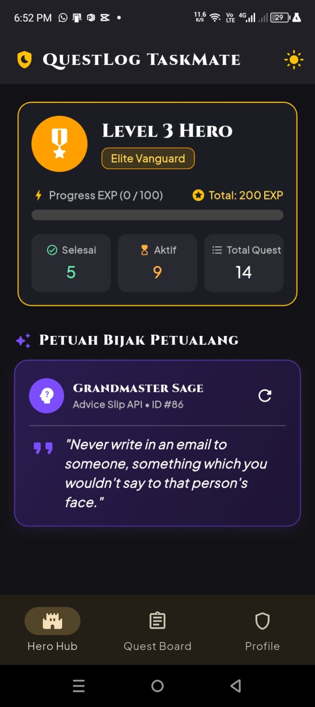
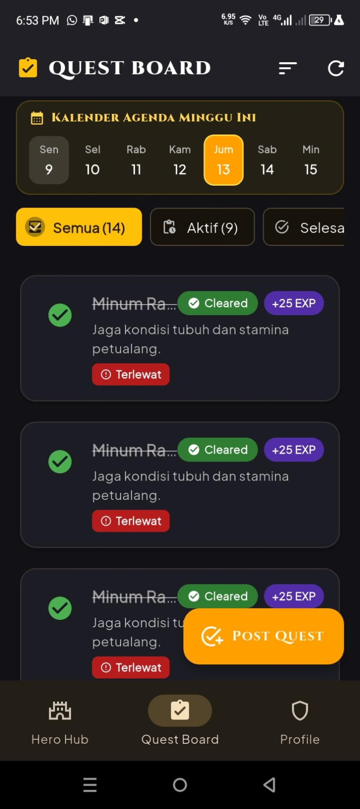
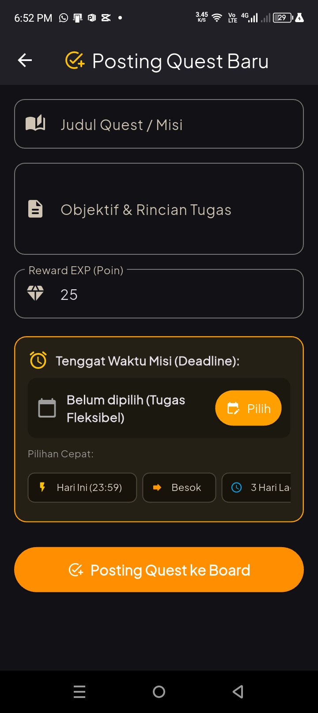
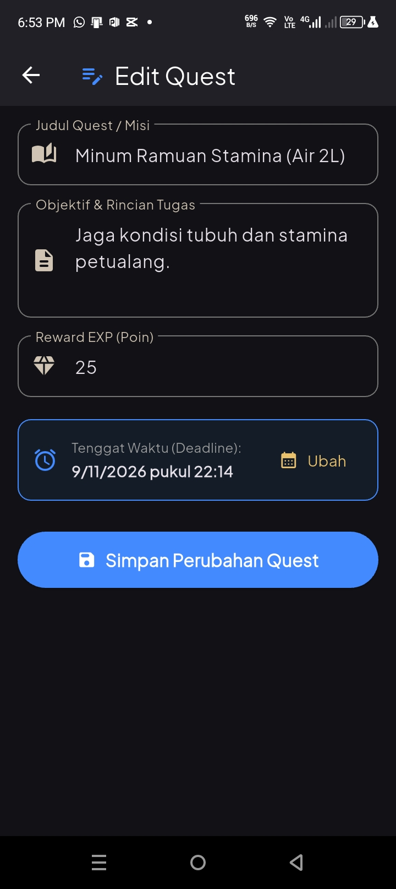
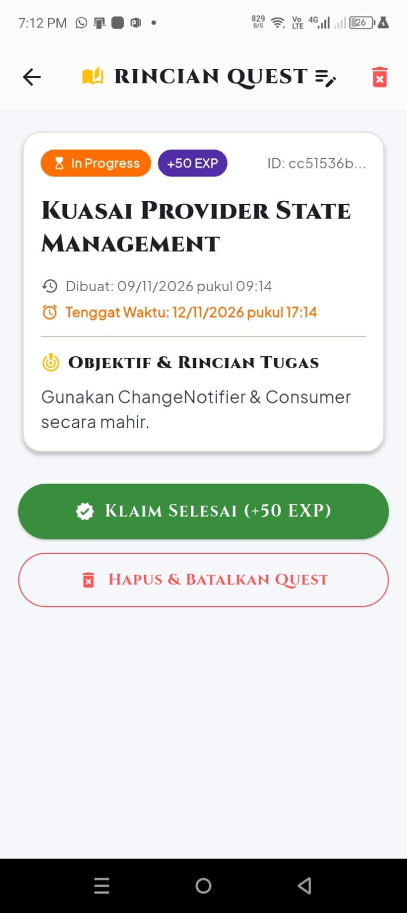
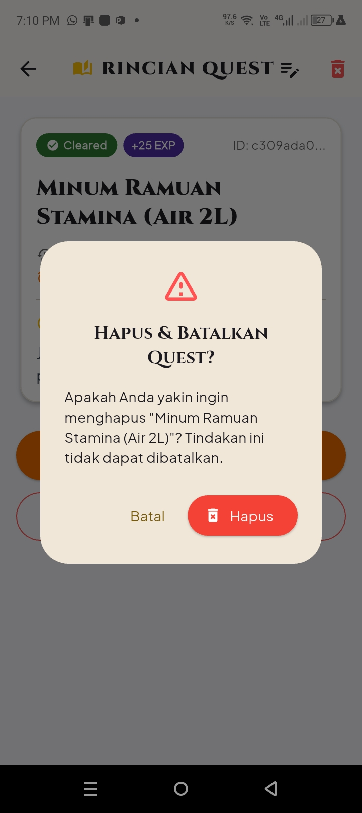
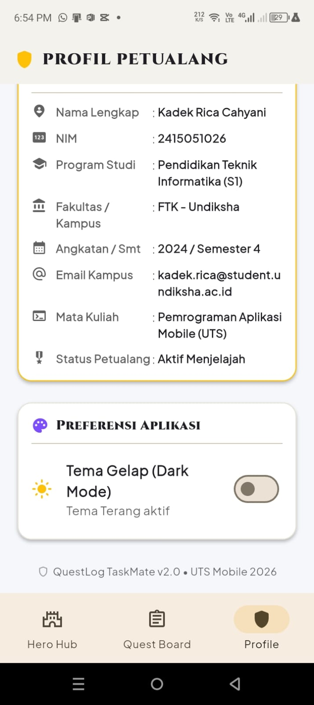

# 🗡️ QuestLog TaskMate

Aplikasi *To-Do List* berbasis *RPG Gamification* yang dibuat untuk memenuhi proyek Ujian Tengah Semester (UTS) mata kuliah Pemrograman Mobile. Aplikasi ini mengubah tugas sehari-hari menjadi *quest* dengan sistem *Experience Points* (EXP).

## 👤 Identitas Pengembang
* **Nama:** Kadek Rica Cahyani
* **NIM:** 2415051026
* **Program Studi:** Pendidikan Teknik Informatika
* **Universitas:** Universitas Pendidikan Ganesha

## 🛠️ Tech Stack & Arsitektur
* **Framework:** Flutter (Dart) dengan Null Safety
* **State Management:** Provider
* **Backend & Database:** Supabase (Full CRUD)
* **REST API:** Advice Slip API (Metode GET untuk *Daily Motivation Quote*)
* **Pola Arsitektur:** MVC ketat (`UI ➔ Provider ➔ Repository ➔ Service ➔ API/DB`)

## 📸 Dokumentasi Screenshot

**1. Home (API Data) & Quest List (Responsive)**
[]
[]

**2. Form Tambah & Edit Tugas (Validation)**
[]
[]

**3. Detail Tugas & Fitur Hapus (AlertDialog)**
[]
[]

**4. Profil & Fitur Kreatif (Dark Mode)**
[]

## 🚀 Cara Menjalankan Aplikasi
1. Buka folder proyek ini di VS Code atau Android Studio.
2. Buka terminal dan jalankan perintah `flutter pub get` untuk mengunduh *dependencies*.
3. Sambungkan ke Emulator atau HP fisik, lalu jalankan perintah `flutter run`.